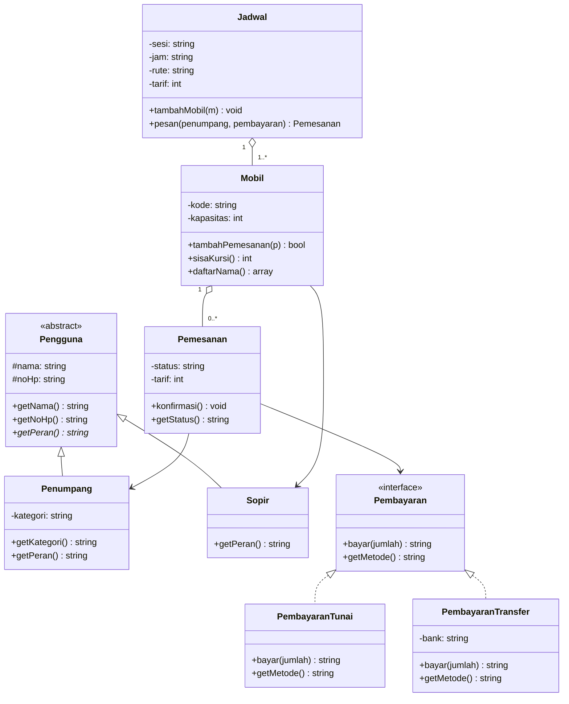

# Sampit Travel Apps (PBO Lab 10)

Aplikasi pemesanan mobil travel Terminal Patih Rumbih Sampit. Repository ini berisi kode PHP hasil penerjemahan UML class diagram.

## Jadwal Layanan

| Sesi | Jam (WIB) | Rute | Mobil | Tarif |
|---|---|---|---|---|
| Pagi | 08.00 - 10.00 | Sampit - Banjarmasin | 2 | Rp 500.000 |
| Siang | 13.00 - 15.00 | Sampit - Palangkaraya & Sampit - Pangkalanbun | 4 | Rp 300.000 |
| Malam | 16.00 - 20.00 | Sampit - Kuala Pembuang | 2 | Rp 250.000 |

## Menjalankan

```
php index.php
```

## Class Diagram



## Relasi Antarkelas

| Jenis Relasi | Kelas |
|---|---|
| Generalisasi | `Penumpang` dan `Sopir` meng-extends `Pengguna` |
| Realisasi | `PembayaranTunai` dan `PembayaranTransfer` meng-implements `Pembayaran` |
| Agregasi | `Jadwal` o-- `Mobil`, dan `Mobil` o-- `Pemesanan` |

## Struktur Folder

```
pbo-sampit-travel-apps/
├── index.php
├── README.md
└── src/
    ├── Jadwal.php
    ├── Mobil.php
    ├── Pembayaran.php
    ├── PembayaranTransfer.php
    ├── PembayaranTunai.php
    ├── Pemesanan.php
    ├── Pengguna.php
    ├── Penumpang.php
    └── Sopir.php
```

Catatan: kapasitas 7 kursi per mobil adalah asumsi.

## Anggota Kelompok

1. Rahmansyah
2. Okta Ramadhani
3. M. Fitriannur Akbar
4. Novy Astoty
5. Ega Apriliani
6. Ruli Sihab
